## operaciones basicas con opencv
## alumno Daniel Nieves NC=1343

## Imagen Original
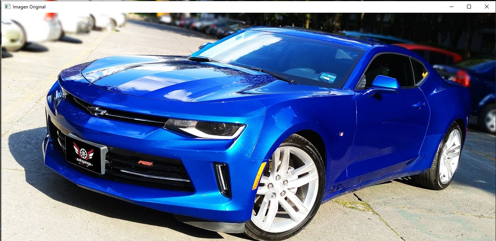
# 1. LECTURA DE LA IMAGEN DESDE LA CARPETA
## Cuando no puede cargar la imagen
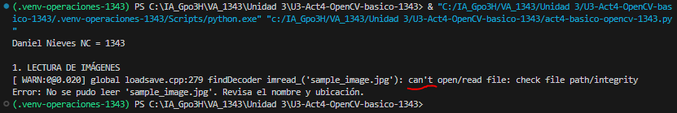
## Cuando carga la imagen
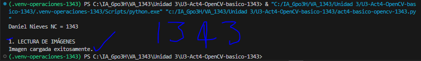
## 2. Propiedades de la imagen 
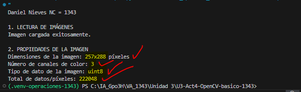
## 3. visualizacion de la imagen original
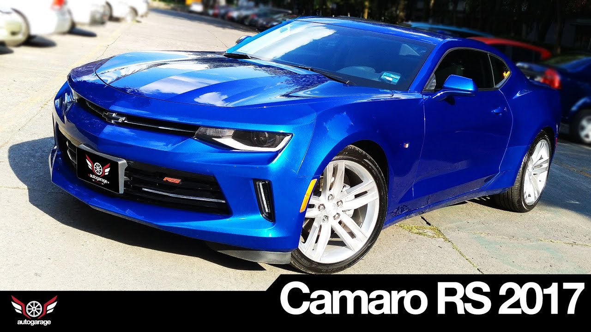
## En la terminal
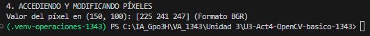
# 4. ACCESO Y MODIFICACION DE PIXELES 
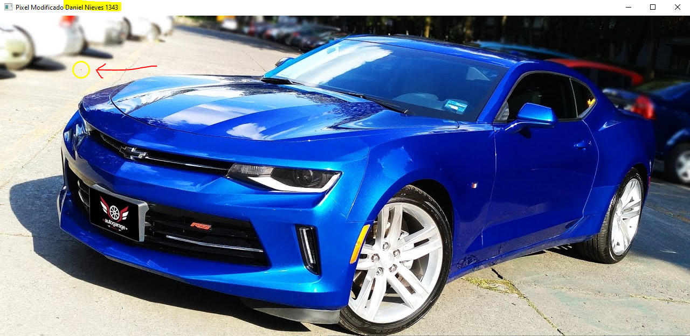
# 5. region de interes
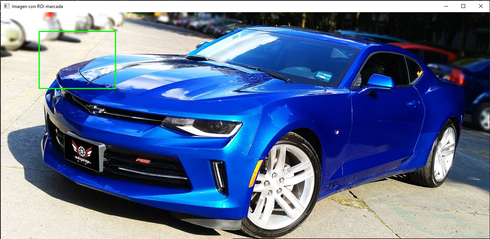
# 6. 
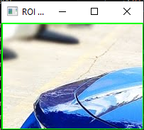
# escala de grises 
# canal rojo
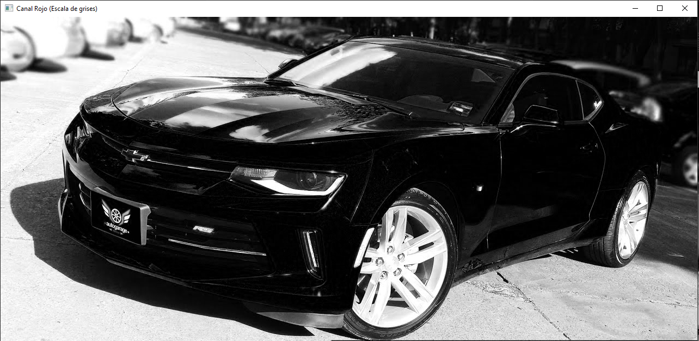
# canal verde
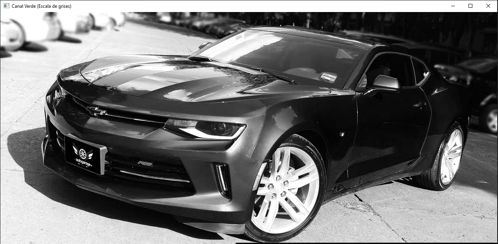
# canal azul
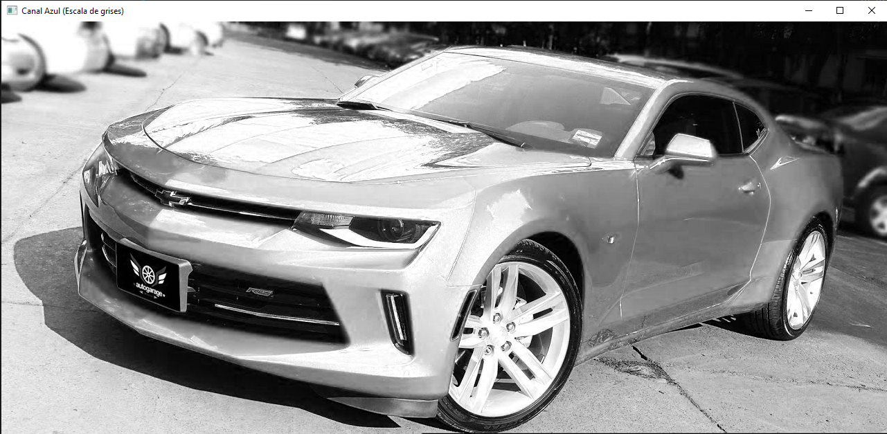
# escala a color 
# rojo 
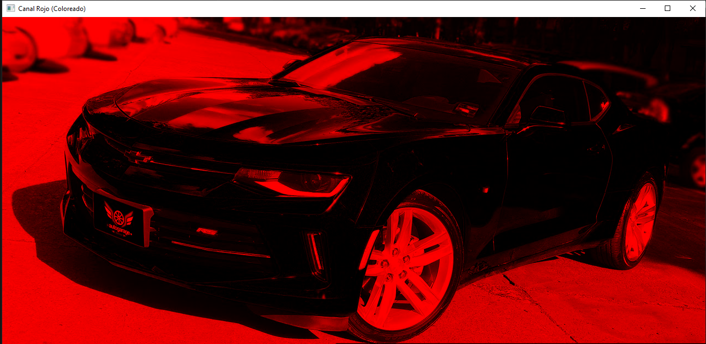
# azul
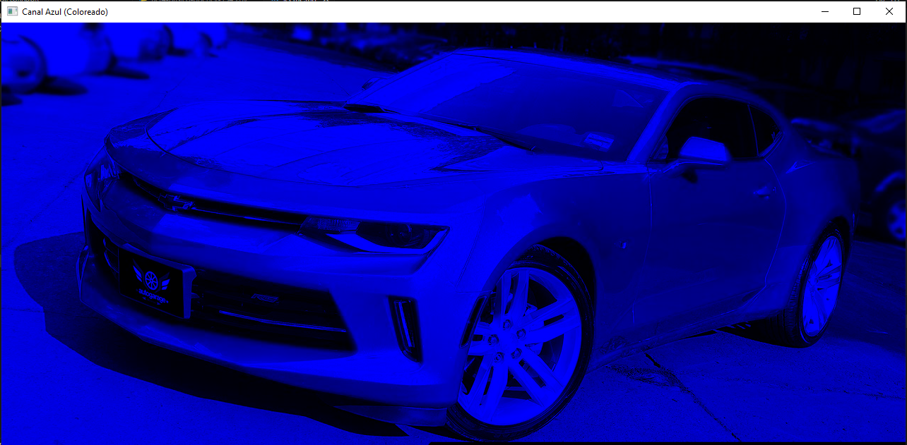
# verde
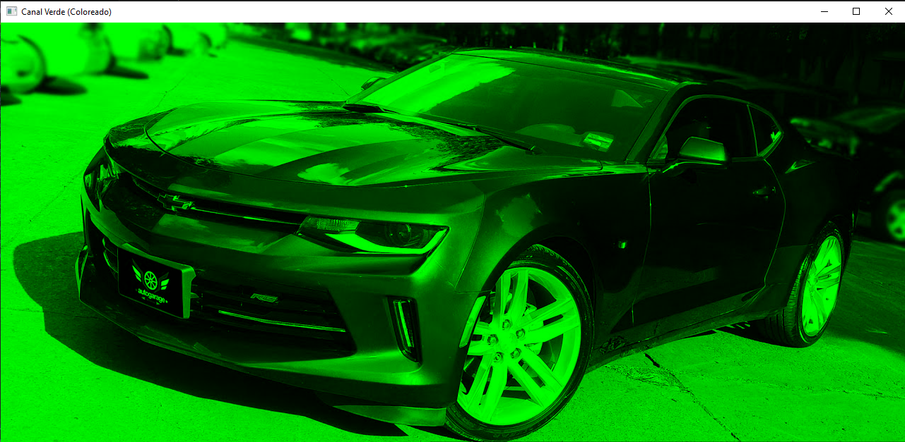
# 7 Redimension de Imagen
# 400 x 300
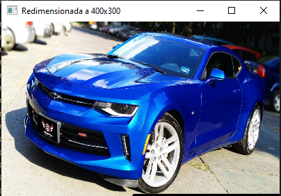
# mitad de tamaño

# x 1.5
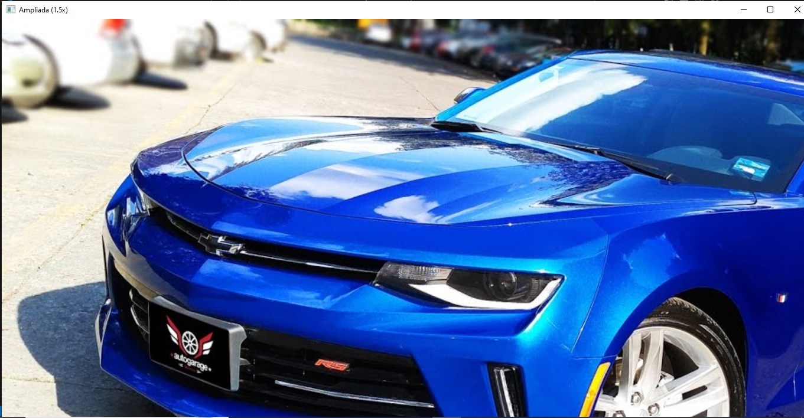
# ROTACION DE IMAGENES
# 45 grados
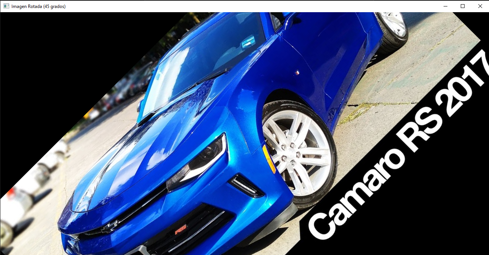
# IMAGEN ESPEJO 
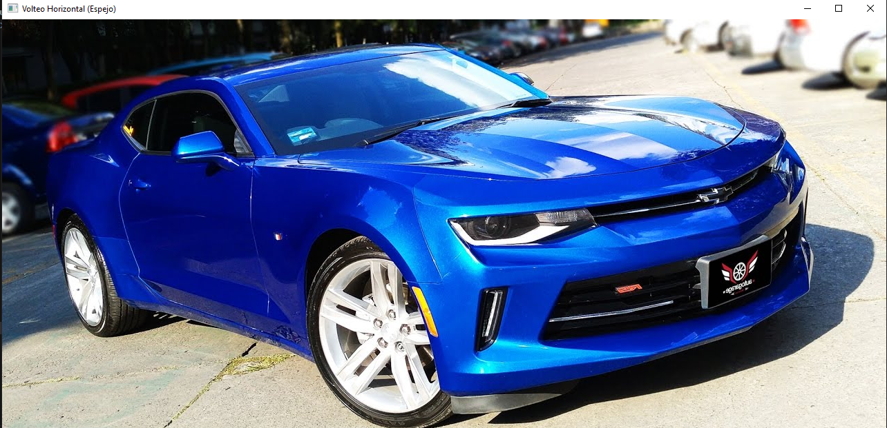
# IMAGEN VOLTEADA
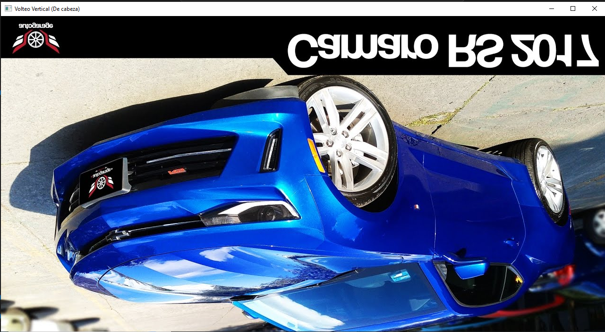
# HACIA EL AMBOS EJES
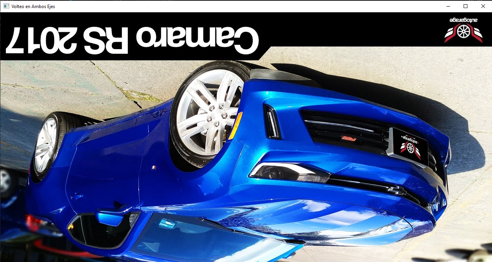